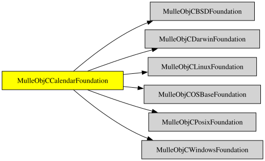

# MulleObjCCalendarFoundation

#### 📆 Calendar class NSCalendar

Adds a Gregorian and a Julian `NSCalendar` to the [MulleFoundation](//github.com/MulleFoundation).


| Release Version                                       | Release Notes  | AI Documentation
|-------------------------------------------------------|----------------|---------------
|  [](//github.com/MulleFoundation/MulleObjCCalendarFoundation/actions) | [RELEASENOTES](RELEASENOTES.md) | [DeepWiki for MulleObjCCalendarFoundation](https://deepwiki.com/MulleFoundation/MulleObjCCalendarFoundation)


## API

| Class               | Description
|---------------------|-----------------------
| `NSCalendar`        |
| `NSDateComponents`  |


## Documentation & Guides

* [API Summary](asset/dox/api/toc)


## Requirements

|   Requirement         | Release Version  | Description
|-----------------------|------------------|---------------
| [MulleObjCOSBaseFoundation](https://github.com/MulleFoundation/MulleObjCOSBaseFoundation) |  [](https://github.com/MulleFoundation/MulleObjCOSBaseFoundation/actions/workflows/mulle-sde-ci.yml) | 
| [MulleObjCPosixFoundation](https://github.com/MulleFoundation/MulleObjCPosixFoundation) |  [](https://github.com/MulleFoundation/MulleObjCPosixFoundation/actions/workflows/mulle-sde-ci.yml) | 
| [MulleObjCBSDFoundation](https://github.com/MulleFoundation/MulleObjCBSDFoundation) |  [](https://github.com/MulleFoundation/MulleObjCBSDFoundation/actions/workflows/mulle-sde-ci.yml) | 
| [MulleObjCDarwinFoundation](https://github.com/MulleFoundation/MulleObjCDarwinFoundation) |  [](https://github.com/MulleFoundation/MulleObjCDarwinFoundation/actions/workflows/mulle-sde-ci.yml) | 
| [MulleObjCLinuxFoundation](https://github.com/MulleFoundation/MulleObjCLinuxFoundation) |  [](https://github.com/MulleFoundation/MulleObjCLinuxFoundation/actions/workflows/mulle-sde-ci.yml) | 
| [MulleObjCWindowsFoundation](https://github.com/MulleFoundation/MulleObjCWindowsFoundation) |  [](https://github.com/MulleFoundation/MulleObjCWindowsFoundation/actions/workflows/mulle-sde-ci.yml) | 
| [mulle-objc-tools](https://github.com/mulle-objc/mulle-objc-tools) |  [](https://github.com/mulle-objc/mulle-objc-tools/actions/workflows/mulle-sde-ci.yml) | 📒 Lists mulle-objc runtime information contained in executables.

### You are here



## Add

Use [mulle-sde](//github.com/mulle-sde) to add MulleObjCCalendarFoundation to your project:

``` sh
mulle-sde add github:MulleFoundation/MulleObjCCalendarFoundation
```

## Install

Use [mulle-sde](//github.com/mulle-sde) to build and install MulleObjCCalendarFoundation and all dependencies:

``` sh
mulle-sde install --prefix /usr/local \
   https://github.com/MulleFoundation/MulleObjCCalendarFoundation/archive/latest.tar.gz
```

### Manual Installation

Install the requirements:

| Requirements                                 | Description
|----------------------------------------------|-----------------------
| [MulleObjCOSBaseFoundation](https://github.com/MulleFoundation/MulleObjCOSBaseFoundation)             | 
| [MulleObjCPosixFoundation](https://github.com/MulleFoundation/MulleObjCPosixFoundation)             | 
| [MulleObjCBSDFoundation](https://github.com/MulleFoundation/MulleObjCBSDFoundation)             | 
| [MulleObjCDarwinFoundation](https://github.com/MulleFoundation/MulleObjCDarwinFoundation)             | 
| [MulleObjCLinuxFoundation](https://github.com/MulleFoundation/MulleObjCLinuxFoundation)             | 
| [MulleObjCWindowsFoundation](https://github.com/MulleFoundation/MulleObjCWindowsFoundation)             | 
| [mulle-objc-tools](https://github.com/mulle-objc/mulle-objc-tools)             | 📒 Lists mulle-objc runtime information contained in executables.

Download the latest [tar](https://github.com/MulleFoundation/MulleObjCCalendarFoundation/archive/refs/tags/latest.tar.gz) or [zip](https://github.com/MulleFoundation/MulleObjCCalendarFoundation/archive/refs/tags/latest.zip) archive and unpack it.

Install **MulleObjCCalendarFoundation** into `/usr/local` with [cmake](https://cmake.org):

``` sh
PREFIX_DIR="/usr/local"
cmake -B build                               \
      -DMULLE_SDK_PATH="${PREFIX_DIR}"       \
      -DCMAKE_INSTALL_PREFIX="${PREFIX_DIR}" \
      -DCMAKE_PREFIX_PATH="${PREFIX_DIR}"    \
      -DCMAKE_BUILD_TYPE=Release &&
cmake --build build --config Release &&
cmake --install build --config Release
```

## Author

[Nat!](https://mulle-kybernetik.com/weblog) for Mulle kybernetiK  


